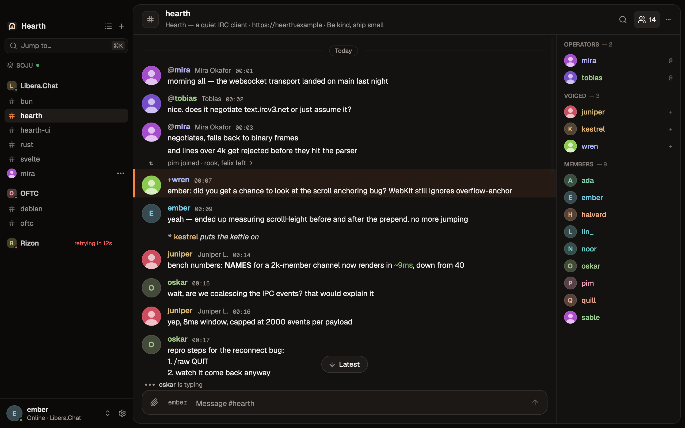
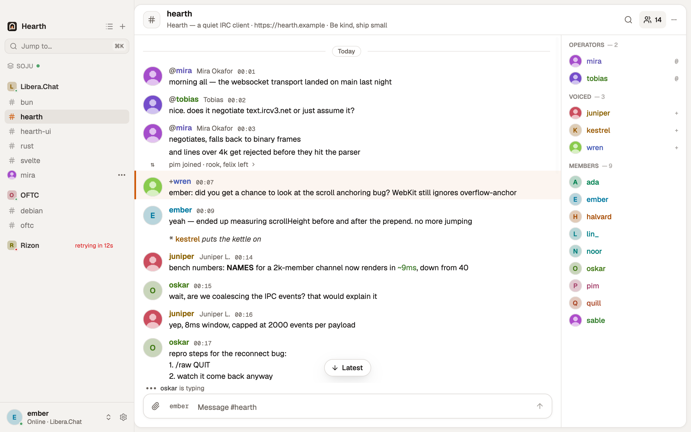
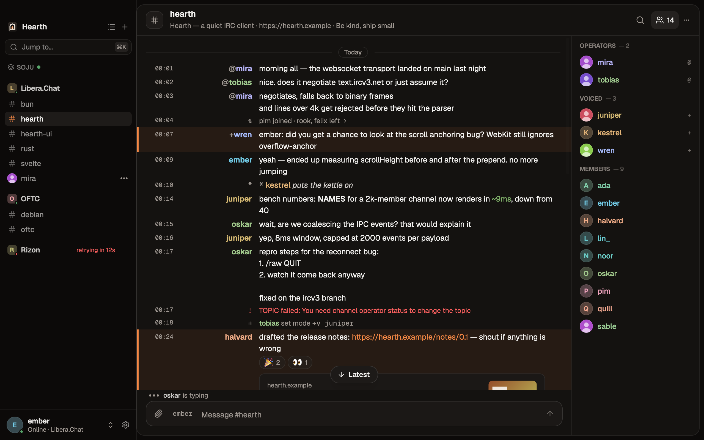
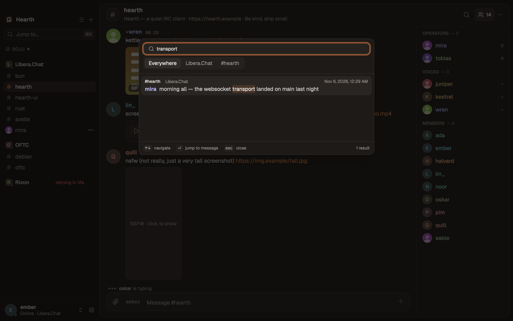
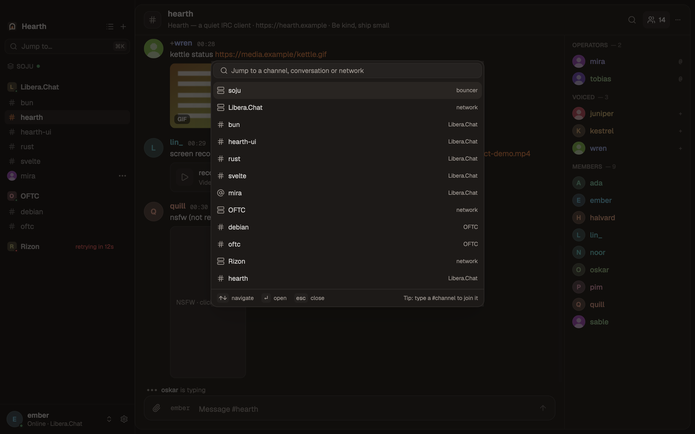
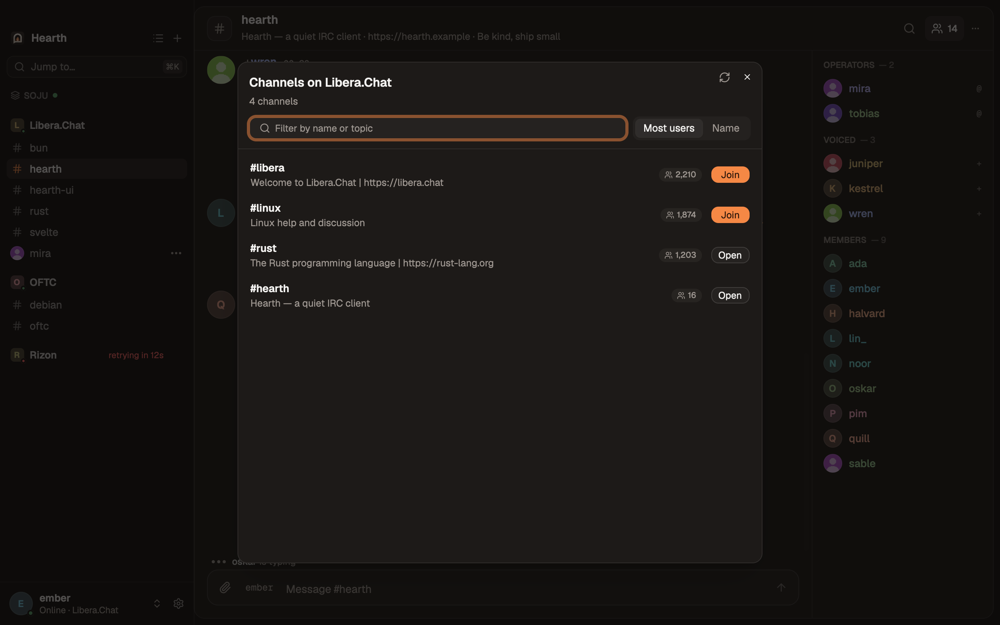
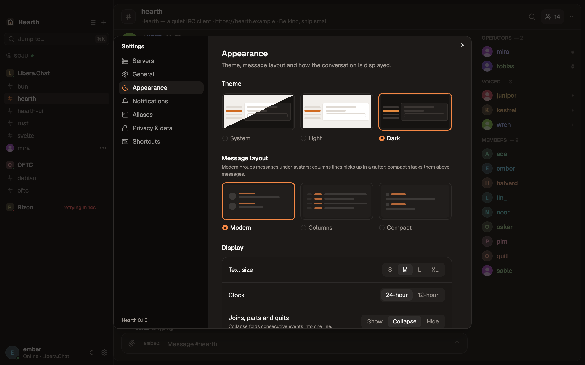

<p align="center">
  
</p>

<h1 align="center">Hearth</h1>

<p align="center">
  A modern, quiet IRC client for macOS, Windows and Linux.<br>
  Full IRCv3, first-class soju bouncer support, searchable local history.
</p>

<p align="center">
  <a href="https://github.com/madrazaldi/hearth/releases/latest"></a>
  <a href="https://github.com/madrazaldi/hearth/actions/workflows/ci.yml"></a>
  <a href="LICENSE"></a>
</p>

<p align="center">
  
</p>

Hearth is a native Rust app: an IRC engine (`crates/hearth-core`) that handles connections, storage and the keychain, a toolkit-free client state model (`crates/hearth-model`), and a GPU-rendered interface built with [GPUI Kit](https://github.com/longbridge/gpui-kit) (`crates/hearth-app`). It treats modern IRC features (history, read markers, replies, reactions, multiline messages) as part of the client rather than add-ons.

## Download

Get the latest installer from the [releases page](https://github.com/madrazaldi/hearth/releases/latest):

| Platform | File |
| --- | --- |
| Windows | `hearth-x.y.z-windows-x86_64-setup.exe` |
| macOS (Apple silicon) | `hearth-x.y.z-macos-aarch64.dmg` |
| macOS (Intel) | `hearth-x.y.z-macos-x86_64.dmg` |
| Linux | `hearth-x.y.z-linux-x86_64.AppImage` or `.deb` |

The macOS app, the Windows installer and the AppImage update themselves: new versions show up under Settings › General. The `.deb` updates with your package manager.

> [!NOTE]
> The macOS build is not notarized yet, so Gatekeeper blocks the first launch. Right-click Hearth in Applications and choose **Open**, or run `xattr -dr com.apple.quarantine /Applications/Hearth.app`. On Windows, SmartScreen may warn about an unrecognized app until the installers are code-signed.

## Screenshots

<table>
  <tr>
    <td></td>
    <td></td>
  </tr>
  <tr>
    <td align="center">Light theme</td>
    <td align="center">Columns layout</td>
  </tr>
  <tr>
    <td></td>
    <td></td>
  </tr>
  <tr>
    <td align="center">Search across every buffer and the bouncer</td>
    <td align="center">Quick switcher (⌘K)</td>
  </tr>
  <tr>
    <td></td>
    <td></td>
  </tr>
  <tr>
    <td align="center">Channel browser</td>
    <td align="center">Settings</td>
  </tr>
</table>

## Features

- **Transports:** plain TCP, TLS and IRC-over-WebSocket (`text.ircv3.net`). Self-signed certificates can be allowed per server.
- **IRCv3:** CAP 302 with `cap-notify`, SASL PLAIN, SCRAM-SHA-256 (falls back to PLAIN) and EXTERNAL, STS (upgrades to TLS and remembers the policy), `labeled-response`, `server-time`, `message-tags`, `batch`, `echo-message`, `away-notify`, `account-notify`, `extended-join`, `chghost`, `setname`, `multi-prefix`, `userhost-in-names`, `invite-notify`, `draft/chathistory`, `draft/event-playback`, `draft/read-marker`, `draft/message-redaction` (receive and delete your own messages), `draft/multiline` (messages with line breaks are sent and shown as one), `standard-replies` (FAIL/WARN/NOTE shown next to the command that caused them), `draft/channel-rename`, `draft/account-registration`, `draft/metadata-2` (display names, and avatars in the member list when enabled under Privacy), `+typing`, `+draft/reply`, `+draft/react` and `MONITOR` / `extended-monitor`.
- **soju bouncer support:** one server entry expands into every bouncer network (`soju.im/bouncer-networks`), and networks added or removed on the bouncer show up live. Networks can be added, edited and removed from the server's settings page. Message search uses `soju.im/search` when available. File uploads go through `soju.im/FILEHOST`, by drag and drop, paste or the paperclip button.
- **History:** backlog loads when you join a channel and older pages load as you scroll up. Private conversations from the last 14 days are rediscovered with `CHATHISTORY TARGETS`.
- **Saved scrollback:** messages are stored locally in SQLite (`hearth.db` in the app-data directory), so scrollback survives restarts and works on servers without chathistory. It can be turned off and wiped under Settings → Privacy & data.
- **Search:** ⌘⇧F searches every buffer, one network or the current buffer, using the local full-text index plus bouncer search. Narrow it with `from:nick`, `in:#channel`, `on:`, `before:` and `after:` (a `YYYY-MM-DD` date, `today` or `yesterday`); `from:` and `in:` autocomplete. Older results load as you scroll. Choosing a result jumps to the message even if it was never loaded: the history around it is fetched, and the messages between it and the present fill in as you scroll. Reopening search brings back the last query and results.
- **Replies and reactions:** hover a message to reply, react, copy it or delete your own.
- **Link previews** (opt-in): pages and images are fetched by the engine, never by the interface, and it refuses local and private addresses at every redirect.
- **Inline images**: with link previews on, image links (including soju FILEHOST uploads) show as thumbnails you can open full size. Images are checked by their bytes (PNG, JPEG, GIF, WebP; at most 8 MB), animations play on hover unless autoplay is on, and images in messages that mention NSFW stay blurred until clicked. Video and audio links get a compact card that opens in your browser; nothing is streamed into the app.
- **Channel browser** for `/list`, with filtering and sorting.
- **Saved buffers:** open channels and private conversations are remembered per network, including channel keys, and restored on launch.
- **Ignore list** with nick or `nick!user@host` wildcard masks. **Per-buffer notifications:** all messages, mentions only, or muted.
- **Watch list:** MONITOR shows online presence for private conversations and announces watched nicks.
- **Tray:** optionally keep running in the menu bar or system tray when the window closes, and mark yourself away after a period in the background.
- **Unread state:** read markers sync between devices, the sidebar shows unread counts and mention badges, a "New" divider marks where you left off, and the dock badge (the tray tooltip on Windows and Linux) counts mentions.
- **Desktop notifications** for mentions, highlight words and private messages.
- **Highlight rules:** global highlight words, plus per-server words and `/regex/flags` patterns with a live test field, and "never highlight" nicks or masks for bots and relays.
- **Aliases:** your own slash commands, set up under Settings → Aliases. For example `/ns` → `/msg NickServ $*`. They support `$1`…`$9`, `$2-`, `$*`, `$nick`, `$channel` and `$network`, and several commands separated by `;`. An alias can replace a built-in command and still call it.
- **Commands on connect:** raw lines to send after each connection, per server (Advanced section of the server form).
- **Composer:**
  - Tab completion for nicks (most recent speakers first), channels, commands and aliases.
  - Emoji suggestions while typing `:name` (for example `:j` offers `:joy:`), and `:name:` turns into its emoji.
  - Command and alias suggestions as you type.
  - No spellcheck yet: GPUI has no spellchecker hook, so the native app cannot underline words.
  - Input history.
  - Multi-line sends.
  - Long messages split on word boundaries.
- **Rendering:**
  - mIRC formatting, including the extended 99-colour palette and hex colours.
  - Clickable links and `#channels`.
  - Stable per-nick colours computed in OKLCH.
  - Collapsed join/part/quit runs.
  - WHOIS results shown as cards.
  - Collapsible MOTD.
- **Layouts:** "modern", with avatars and each sender's messages grouped; "columns", with nicks aligned in a gutter; or "compact", with nicks above grouped messages. Light, dark and system themes. Adjustable text size.
- **Reliability:**
  - Automatic reconnect with exponential backoff and keepalive pings.
  - Channels you were in are rejoined after reconnecting.
  - Outgoing lines are rate-limited on direct connections, and the send queue is capped.
  - CTCP replies are rate-limited.
- **Security:**
  - Passwords are kept in the OS keychain, and existing plain-text passwords are migrated out of the config file.
  - Client certificates (CertFP) can be generated in the app.

## Commands

Type `/help` in the app for the full list. The main ones are `/join`, `/part`, `/msg`, `/query`, `/me`, `/notice`, `/nick`, `/topic`, `/whois`, `/away`, `/back`, `/invite`, `/kick`, `/ban`, `/unban`, `/op`, `/deop`, `/voice`, `/devoice`, `/mode`, `/names`, `/ctcp`, `/raw`, `/clear`, `/close`, `/reconnect`, `/quit` and `/list` (opens the channel browser). Also: `/search`, `/ignore` and `/unignore` (no argument lists the ignores), `/watch` and `/unwatch` (alias `/monitor`), `/notify all|mentions|none` (with `/mute` and `/unmute` as shortcuts), `/rename [#channel] <#new> [reason]` on servers with `draft/channel-rename`, and `/register <email|*> <password>` and `/verify <account> <code>` on servers with `draft/account-registration` (a successful registration offers to save the login for SASL). Aliases you define in Settings → Aliases work like commands and are listed in `/help`. Anything else is sent to the server verbatim.

## Shortcuts

| Keys | Action |
| --- | --- |
| ⌘K | Jump to any buffer (type a `#channel` to join it) |
| ⌥↑ / ⌥↓ | Previous / next buffer (add ⇧ for unread only) |
| ⌘1–9 | Go to the Nth channel |
| ⌘F | Filter messages in the current buffer |
| ⌘⇧F | Search messages |
| ⌘W | Close the window (Ctrl+W closes or leaves the buffer on Windows and Linux) |
| ⌘⇧M | Toggle the member list |
| ⌘, | Open Settings |
| ⌘/ | Show all keyboard shortcuts |
| Esc | Close a panel or cancel a reply |
| Tab / ⇧Tab | Complete a nick, channel, command or alias |
| ↑ / ↓ | Input history |
| ⇧↵ | New line |

On Windows and Linux, use Ctrl instead of ⌘ and Alt instead of ⌥.

## Development

You need a stable [Rust toolchain](https://rustup.rs) (see `rust-version` in `Cargo.toml`). On Linux, install the libraries GPUI needs with `scripts/install-linux-deps.sh`. The first build compiles GPUI and takes a few minutes; later builds are incremental.

```sh
cargo run                          # the app (crates/hearth-app), with your real config and logs
HEARTH_MOCK=1 cargo run            # the app against a scripted IRC session, no server needed
cargo test --workspace             # engine, client state and app tests
cargo clippy --workspace --all-targets -- -D warnings
cargo fmt --all                    # rustfmt.toml sets the line width
cargo xtask screenshots            # regenerate docs/screenshots offscreen (no window opens)
```

`HEARTH_MOCK=1` (or `--mock`) replays a scripted session from `crates/hearth-model/src/mock.rs` (Libera.Chat, OFTC and Rizon behind a soju bouncer), so UI work needs no server. Environment variables shape it: `HEARTH_THEME=light|dark|system`, `HEARTH_LAYOUT=columns|compact`, `HEARTH_VIEW=settings|switcher|search|channels|shortcuts`, `HEARTH_TAB=<settings tab>` and `HEARTH_SERVER=<id>` (edit a server), `HEARTH_BUFFER=<buffer>`, `HEARTH_QUERY=<search>`, `HEARTH_UPDATE=available|error` (the scripted updater's answer; by default there is no update), `HEARTH_EMPTY=1` (first-run screen), `HEARTH_NOAVATARS=1`, and `HEARTH_STRESS=1` (a `#stress` channel with about 10k lines of scrollback and 5k members, for performance work; `HEARTH_STRESS=live` adds a new line every 3 seconds). `HEARTH_BACKGROUND=1` opens the window without taking focus.

A development run uses the same config and log directories as an installed Hearth (the identifier is still `app.hearth.irc`, and the keychain entries are the ones earlier versions wrote, so existing installs carry over). Set `HEARTH_CONFIG_DIR` and `HEARTH_DATA_DIR` to point it at throwaway data instead.

CI (`.github/workflows/ci.yml`) runs on every push and pull request: formatting, clippy and the tests on Linux, macOS and Windows, and a check that every crate follows the workspace version.

To smoke-test the engine headlessly against a real server:

```sh
HEARTH_HOST=irc.libera.chat HEARTH_NICK=someone cargo run -p hearth-core --example probe
```

## Releasing

Versions follow [semver](https://semver.org). The version lives once, in the workspace `Cargo.toml`, and CI fails if a crate or `Cargo.lock` disagrees.

1. Run `cargo xtask bump 0.2.0`.
2. Commit (`chore(release): v0.2.0`), then tag and push: `git tag v0.2.0 && git push origin main v0.2.0`. The tag must match the version.
3. `.github/workflows/release.yml` runs CI, then builds macOS (Apple silicon and Intel), Linux and Windows installers with [cargo-packager](https://github.com/crabnebula-dev/cargo-packager) into a **draft** GitHub Release, plus the `latest.json` the updater reads. The release notes are generated from the commits since the previous tag by [git-cliff](https://git-cliff.org) (`cliff.toml`), grouped by conventional-commit type, so prefer `feat:`, `fix:` and `perf:` prefixes. The workflow can also be started by hand from the Actions tab.
4. Check the draft, edit the notes if needed, and publish it. The in-app updater reads `https://github.com/madrazaldi/hearth/releases/latest/download/latest.json`, which only sees published releases.

Updates are signed with [minisign](https://jedisct1.github.io/minisign/): the public key is compiled into the app, and an update whose signature does not verify is refused. Builds without a key (development builds, forks) never update themselves.

Everything below is optional; without a group's secrets the workflow still builds, just unsigned or without updates (Repository secrets under Settings > Secrets and variables > Actions):

| Secret | Purpose |
| --- | --- |
| `UPDATER_PRIVATE_KEY`, `UPDATER_PRIVATE_KEY_PASSWORD` | Signs update archives. Generate a pair with `cargo packager signer generate`. |
| `UPDATER_PUBKEY` | The public half, compiled into the app. |
| `MACOS_CERTIFICATE` | Base64 of a Developer ID Application `.p12`. |
| `MACOS_CERTIFICATE_PASSWORD` | Password of that `.p12`. |
| `MACOS_DEVELOPER_ID` | For example `Developer ID Application: Name (TEAMID)`. |
| `MACOS_APPLE_ID`, `MACOS_APPLE_PASSWORD`, `MACOS_TEAM_ID` | Apple ID, app-specific password and team, to notarize. |

The `ELECTROBUN_*` names the macOS secrets had before are still read. Windows and Linux builds are not code-signed, so SmartScreen warns on first run there. Without Apple secrets the macOS app is unsigned and Gatekeeper blocks the first launch (see Download).

To build an installer locally: `cargo install cargo-packager --locked`, then `cargo packager --release -p hearth-app`.

Dependabot (`.github/dependabot.yml`) opens grouped monthly PRs for Cargo and GitHub Actions updates.

## Architecture

```
crates/hearth-core    the engine: IRC connections, log store, keychain, previews, uploads, and `Core`, every command the app calls
crates/hearth-model   the client state: connections, buffers, incoming messages, history, unread counts, slash commands, and the scripted mock
crates/hearth-app     the GPUI Kit app: views, the host that runs the model against the engine, and desktop integration
xtask                 version bumps, release staging and screenshots (`cargo xtask`)
```

The engine runs on its own tokio runtime and hands event batches (one per burst) to the app. The model is a synchronous state machine with no UI toolkit or async runtime: it takes engine events in and queues `Effect`s out (send these lines, save these buffers, fetch this history), and the app's host executes them against the engine and feeds results back with `resolve`. That keeps the client logic testable by feeding raw IRC lines.

### Engine (`crates/hearth-core`)

- `app.rs` is `Core`: config and commands. Its async commands return futures that run on the engine's runtime, so the app awaits them from GPUI's executor.
- `irc/message.rs` parses and serializes IRC messages, including tags. `irc/time.rs` handles server-time tags.
- `irc/transport.rs` reduces TCP, TLS (rustls) and WebSocket to a line reader and a line writer.
- `irc/client.rs` runs one actor per connection. It handles registration, CAP and SASL, STS, keepalive, reconnects, labeled-response routing, chathistory batches, folding `draft/multiline` batches into single messages, and message logging.
- `irc/scram.rs` implements SCRAM-SHA-256.
- `irc/manager.rs` owns all connections and spawns a child connection for each bouncer network.
- `irc/events.rs` batches events into a single delivery per burst.
- `store.rs` is the SQLite log (rusqlite, WAL). It holds messages with an FTS5 index, saved buffers and STS policies, and writes are batched into transactions.
- `secrets.rs` stores and loads keychain entries. `certs.rs` generates client certificates and computes their fingerprints. `paths.rs` picks the config and data directories.
- `preview.rs` fetches link previews and metadata avatars, with SSRF guards on every hop and a cache. `upload.rs` handles file uploads.
- `tests/` drive the connection actor against a scripted local server.

### Client state (`crates/hearth-model`)

- `state.rs` (`App`), `conn.rs` and `buffer.rs` hold all client state. `effect.rs` is what the host executes.
- `incoming.rs` turns server messages into state changes.
- `history.rs` loads chathistory, falls back to the local log and dedupes merged lines. It also tracks the gaps a jump leaves between loaded stretches and fills them.
- `search.rs` and `search_panel.rs` parse search filters and page through the local log and the bouncer (buffer by buffer where the bouncer requires `in`).
- `saved.rs`, `monitor.rs`, `unread.rs` and `ignore.rs` save open buffers, track watched nicks, count unread messages and highlights, and match ignore masks.
- `commands.rs` and `aliases.rs` implement slash commands. `multiline.rs` splits composer text into `draft/multiline` batches. `composer.rs` handles completion and input history.
- `format.rs` parses mIRC formatting and finds links. `timeline.rs` groups lines for the message list.
- `panels.rs`, `welcome.rs` and `rows.rs` hold the logic behind the sidebar, switcher, channel browser, settings forms and first-run flow, so the views stay thin.
- `mock.rs` is the scripted session. `testing.rs` feeds raw IRC lines in tests.

### App (`crates/hearth-app`)

- `host/` owns the model in a global GPUI entity that outlives windows, pumps engine events into it, runs effects and timers, and drives the mock in mock mode.
- `ui/` holds the views. `ui/theme.rs` defines the light and dark themes; `ui/keys.rs` the keyboard shortcuts.
- `platform/` is the desktop integration: menus, tray, close-to-tray, notifications, the dock badge, opening links, and the updater.
- `tests/` run the host headlessly against the mock and against a scripted local server; `examples/screenshots.rs` renders the docs screenshots.

Config is stored as JSON in the OS app-config directory with `0600` permissions. Passwords are stored in the OS keychain (service `app.hearth.irc`). If the keychain is unavailable, they stay in the config file instead.

## Contributing

Bug reports, feature requests and pull requests are welcome. See [CONTRIBUTING.md](CONTRIBUTING.md).

## License

Hearth is free software, released under the [GNU General Public License v3.0 or later](LICENSE).
