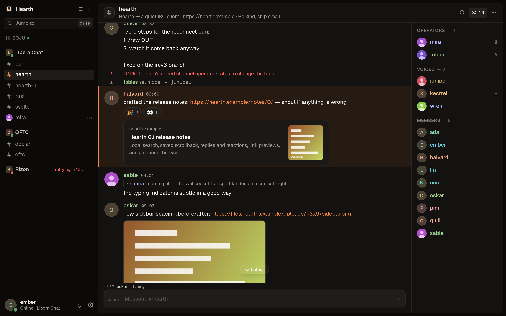
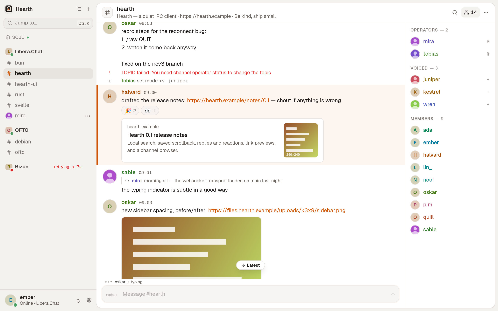
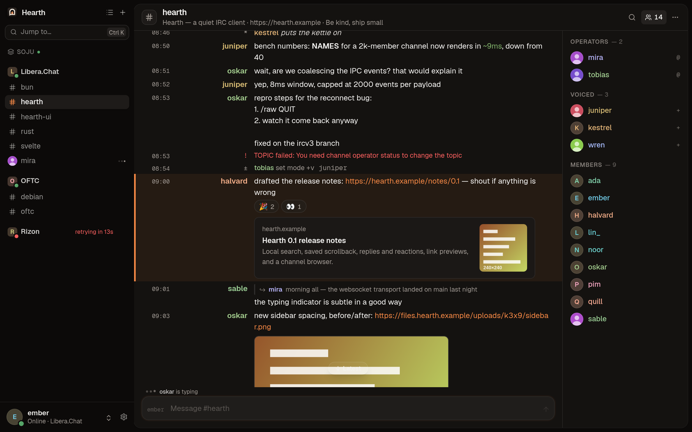
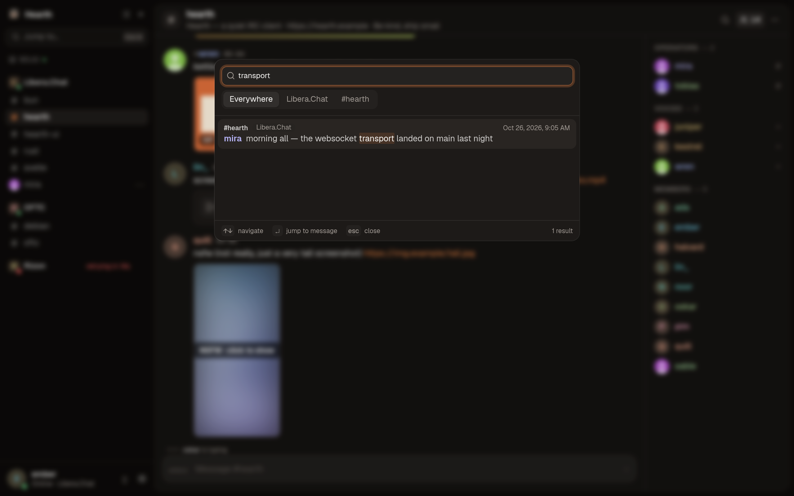
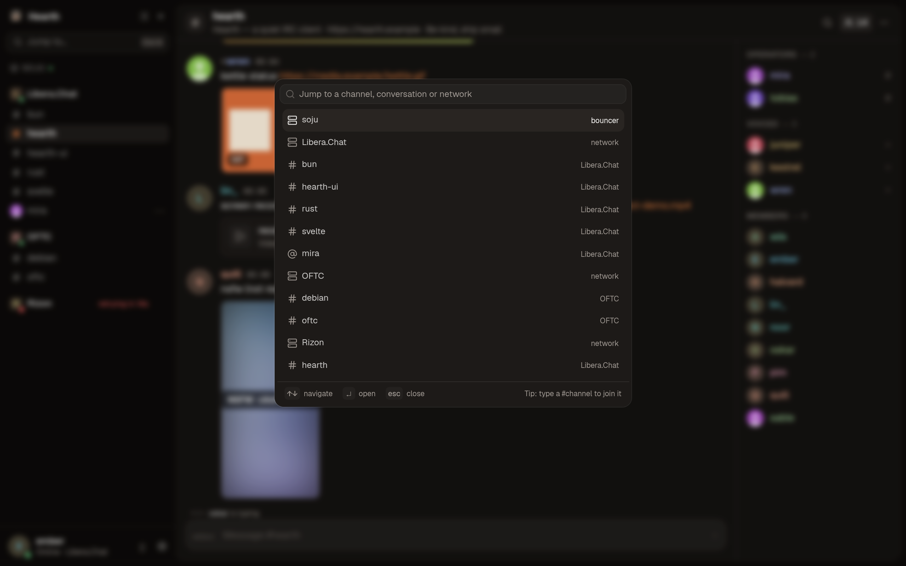
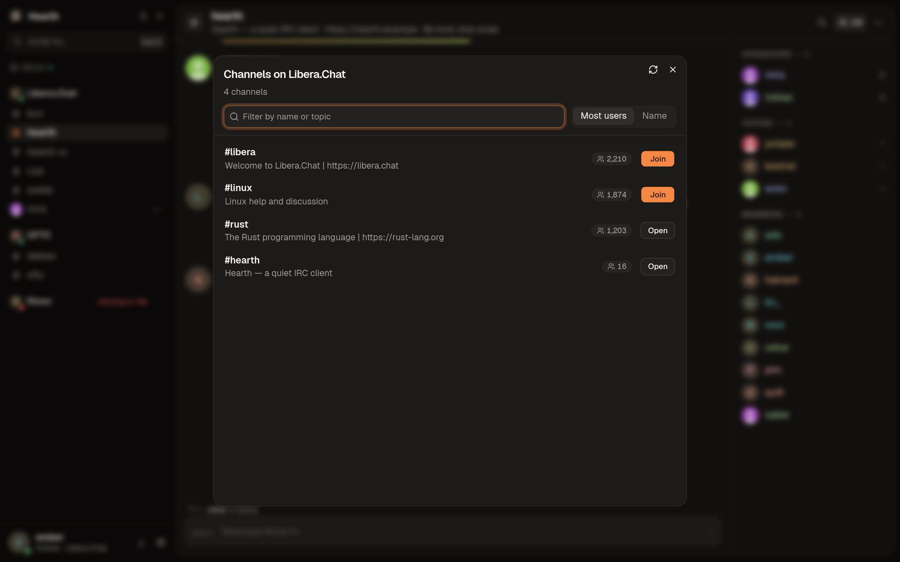
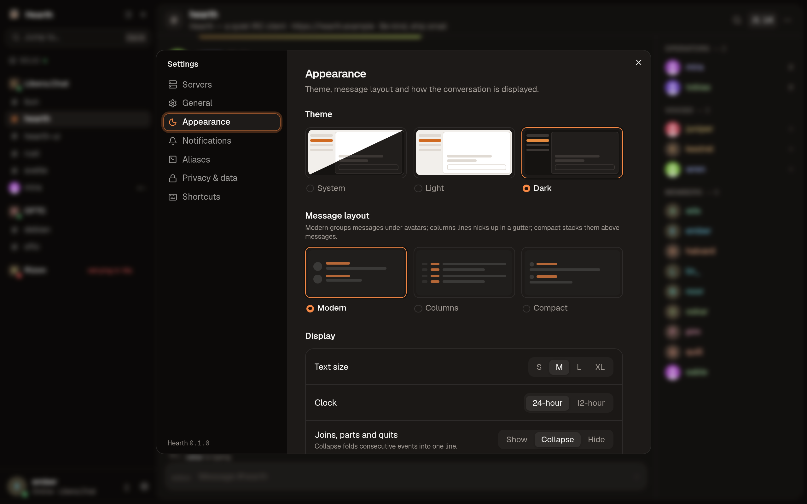

<p align="center">
  
</p>

<h1 align="center">Hearth</h1>

<p align="center">
  A modern, quiet IRC client for macOS, Windows and Linux.<br>
  Full IRCv3, first-class soju bouncer support, searchable local history.
</p>

<p align="center">
  <a href="https://github.com/madrazaldi/hearth/releases/latest"></a>
  <a href="https://github.com/madrazaldi/hearth/actions/workflows/ci.yml"></a>
  <a href="LICENSE"></a>
</p>

<p align="center">
  
</p>

Hearth is built on a TypeScript engine running on Bun (`src/bun/core`) that handles connections, storage and the keychain, with a Svelte 5 interface on top, packaged with [Electrobun](https://electrobun.dev) and its bundled Chromium (CEF). It treats modern IRC features (history, read markers, replies, reactions, multiline messages) as part of the client rather than add-ons.

## Download

Get the latest installer from the [releases page](https://github.com/madrazaldi/hearth/releases/latest):

| Platform | File |
| --- | --- |
| Windows | `Hearth_x.y.z_x64-setup.exe` or `Hearth_x.y.z_x64_en-US.msi` |
| macOS (Apple silicon and Intel) | `Hearth_x.y.z_universal.dmg` |
| Linux | `.AppImage`, `.deb` or `.rpm` |

Hearth updates itself: new versions show up under Settings › General.

> [!NOTE]
> The macOS build is not notarized yet, so Gatekeeper blocks the first launch. Right-click Hearth in Applications and choose **Open**, or run `xattr -dr com.apple.quarantine /Applications/Hearth.app`. On Windows, SmartScreen may warn about an unrecognized app until the installers are code-signed.

## Screenshots

<table>
  <tr>
    <td></td>
    <td></td>
  </tr>
  <tr>
    <td align="center">Light theme</td>
    <td align="center">Columns layout</td>
  </tr>
  <tr>
    <td></td>
    <td></td>
  </tr>
  <tr>
    <td align="center">Search across every buffer and the bouncer</td>
    <td align="center">Quick switcher (⌘K)</td>
  </tr>
  <tr>
    <td></td>
    <td></td>
  </tr>
  <tr>
    <td align="center">Channel browser</td>
    <td align="center">Settings</td>
  </tr>
</table>

## Features

- **Transports:** plain TCP, TLS and IRC-over-WebSocket (`text.ircv3.net`). Self-signed certificates can be allowed per server.
- **IRCv3:** CAP 302 with `cap-notify`, SASL PLAIN, SCRAM-SHA-256 (falls back to PLAIN) and EXTERNAL, STS (upgrades to TLS and remembers the policy), `labeled-response`, `server-time`, `message-tags`, `batch`, `echo-message`, `away-notify`, `account-notify`, `extended-join`, `chghost`, `setname`, `multi-prefix`, `userhost-in-names`, `invite-notify`, `draft/chathistory`, `draft/event-playback`, `draft/read-marker`, `draft/message-redaction` (receive and delete your own messages), `draft/multiline` (messages with line breaks are sent and shown as one), `standard-replies` (FAIL/WARN/NOTE shown next to the command that caused them), `draft/channel-rename`, `draft/account-registration`, `draft/metadata-2` (display names, and avatars in the member list when enabled under Privacy), `+typing`, `+draft/reply`, `+draft/react` and `MONITOR` / `extended-monitor`.
- **soju bouncer support:** one server entry expands into every bouncer network (`soju.im/bouncer-networks`), and networks added or removed on the bouncer show up live. Networks can be added, edited and removed from the server's settings page. Message search uses `soju.im/search` when available. File uploads go through `soju.im/FILEHOST`, by drag and drop, paste or the paperclip button.
- **History:** backlog loads when you join a channel and older pages load as you scroll up. Private conversations from the last 14 days are rediscovered with `CHATHISTORY TARGETS`.
- **Saved scrollback:** messages are stored locally in SQLite (`hearth.db` in the app-data directory), so scrollback survives restarts and works on servers without chathistory. It can be turned off and wiped under Settings → Privacy & data.
- **Search:** ⌘⇧F searches every buffer, one network or the current buffer, using the local full-text index plus bouncer search. Narrow it with `from:nick`, `in:#channel`, `on:`, `before:` and `after:` (a `YYYY-MM-DD` date, `today` or `yesterday`); `from:` and `in:` autocomplete. Older results load as you scroll. Choosing a result jumps to the message even if it was never loaded: the history around it is fetched, and the messages between it and the present fill in as you scroll. Reopening search brings back the last query and results.
- **Replies and reactions:** hover a message to reply, react, copy it or delete your own.
- **Link previews** (opt-in): pages and images are fetched by the Bun backend, which refuses local and private addresses at every redirect.
- **Inline images**: with link previews on, image links (including soju FILEHOST uploads) show as thumbnails you can open full size. Images are checked by their bytes (PNG, JPEG, GIF, WebP; at most 8 MB), animations play on hover unless autoplay is on, and images in messages that mention NSFW stay blurred until clicked. Video and audio links get a compact card that opens in your browser; nothing is streamed into the app.
- **Channel browser** for `/list`, with filtering and sorting.
- **Saved buffers:** open channels and private conversations are remembered per network, including channel keys, and restored on launch.
- **Ignore list** with nick or `nick!user@host` wildcard masks. **Per-buffer notifications:** all messages, mentions only, or muted.
- **Watch list:** MONITOR shows online presence for private conversations and announces watched nicks.
- **Tray:** optionally keep running in the menu bar or system tray when the window closes, and mark yourself away after a period in the background.
- **Unread state:** read markers sync between devices, the sidebar shows unread counts and mention badges, a "New" divider marks where you left off, and the dock badge counts mentions.
- **Desktop notifications** for mentions, highlight words and private messages.
- **Highlight rules:** global highlight words, plus per-server words and `/regex/flags` patterns with a live test field, and "never highlight" nicks or masks for bots and relays.
- **Aliases:** your own slash commands, set up under Settings → Aliases. For example `/ns` → `/msg NickServ $*`. They support `$1`…`$9`, `$2-`, `$*`, `$nick`, `$channel` and `$network`, and several commands separated by `;`. An alias can replace a built-in command and still call it.
- **Commands on connect:** raw lines to send after each connection, per server (Advanced section of the server form).
- **Composer:**
  - Tab completion for nicks (most recent speakers first), channels, commands and aliases.
  - Emoji suggestions while typing `:name` (for example `:j` offers `:joy:`), and `:name:` turns into its emoji.
  - Command and alias suggestions as you type.
  - Spellcheck, which can be turned off. Autocorrect and auto-capitalization stay off.
  - Input history.
  - Multi-line sends.
  - Long messages split on word boundaries.
- **Rendering:**
  - mIRC formatting, including the extended 99-colour palette and hex colours.
  - Clickable links and `#channels`.
  - Stable per-nick colours computed in OKLCH.
  - Collapsed join/part/quit runs.
  - WHOIS results shown as cards.
  - Collapsible MOTD.
- **Layouts:** "modern", with avatars and each sender's messages grouped; "columns", with nicks aligned in a gutter; or "compact", with nicks above grouped messages. Light, dark and system themes. Adjustable text size.
- **Reliability:**
  - Automatic reconnect with exponential backoff and keepalive pings.
  - Channels you were in are rejoined after reconnecting.
  - Outgoing lines are rate-limited on direct connections, and the send queue is capped.
  - CTCP replies are rate-limited.
- **Security:**
  - Passwords are kept in the OS keychain, and existing plain-text passwords are migrated out of the config file.
  - Client certificates (CertFP) can be generated in the app.
  - The UI runs under a strict Content Security Policy.

## Commands

Type `/help` in the app for the full list. The main ones are `/join`, `/part`, `/msg`, `/query`, `/me`, `/notice`, `/nick`, `/topic`, `/whois`, `/away`, `/back`, `/invite`, `/kick`, `/ban`, `/unban`, `/op`, `/deop`, `/voice`, `/devoice`, `/mode`, `/names`, `/ctcp`, `/raw`, `/clear`, `/close`, `/reconnect`, `/quit` and `/list` (opens the channel browser). Also: `/search`, `/ignore` and `/unignore` (no argument lists the ignores), `/watch` and `/unwatch` (alias `/monitor`), `/notify all|mentions|none` (with `/mute` and `/unmute` as shortcuts), `/rename [#channel] <#new> [reason]` on servers with `draft/channel-rename`, and `/register <email|*> <password>` and `/verify <account> <code>` on servers with `draft/account-registration` (a successful registration offers to save the login for SASL). Aliases you define in Settings → Aliases work like commands and are listed in `/help`. Anything else is sent to the server verbatim.

## Shortcuts

| Keys | Action |
| --- | --- |
| ⌘K | Jump to any buffer (type a `#channel` to join it) |
| ⌥↑ / ⌥↓ | Previous / next buffer (add ⇧ for unread only) |
| ⌘1–9 | Go to the Nth channel |
| ⌘F | Filter messages in the current buffer |
| ⌘⇧F | Search messages |
| ⌘W | Close or leave the buffer |
| ⌘⇧M | Toggle the member list |
| ⌘, | Open Settings |
| ⌘/ | Show all keyboard shortcuts |
| Esc | Close a panel or cancel a reply |
| Tab / ⇧Tab | Complete a nick, channel, command or alias |
| ↑ / ↓ | Input history |
| ⇧↵ | New line |

On Windows and Linux, use Ctrl instead of ⌘ and Alt instead of ⌥.

## Development

You need [Bun](https://bun.sh). Electrobun downloads its own runtime and the bundled Chromium (CEF) on first use, so there is no native toolchain to install. On Linux the app needs the usual GTK and tray libraries at runtime.

```sh
bun install
bun run dev            # the UI alone in a browser, against the scripted mock (src/lib/mock.ts)
bun run start          # build the UI and run the real app (Electrobun dev mode)
bun run check          # svelte-check + tsc for the UI, the build scripts and the Bun backend
bun run test           # Vitest for the UI, then bun test for the backend (actor tests against a scripted server)
bun run build          # stable release build into build/ and artifacts/
bun run probe          # headless smoke test of the backend against a real server
```

`electrobun prepare` (run for you by `install`, `start` and `build`) projects the Electrobun SDK into `.hutch/devkit`, which is git-ignored; the UI and backend type-check against it.

When `bun run dev` runs in a plain browser instead of inside the app, Hearth replays a scripted IRC session from `src/lib/mock.ts`. This lets you work on the UI without a server. Query parameters control the preview: `?theme=light`, `?layout=columns|compact`, `?view=settings`, `?view=switcher`, `?view=search`, `?view=channels`, `?view=shortcuts`, `?tab=privacy` (open a Settings tab; add `&server=<id>` to edit a server), `?update=none` (the mock updater reports no update; by default it offers 0.2.0), `?empty` (first-run screen) and `?stress` (a `#stress` channel with about 10k lines of scrollback and 5k members, for performance work; `?stress=live` adds a new line every 3 seconds).

`bun run start` uses the same config and log directories as an installed Hearth (the identifier is still `app.hearth.irc`, so existing installs carry over). Set `HEARTH_CONFIG_DIR` and `HEARTH_DATA_DIR` to point a development run at throwaway data instead.

`bun run screenshots` regenerates the images in `docs/screenshots` from the mock while `bun run dev` is running. It uses an installed Chrome; set `HEARTH_CHROME` to the binary of another Chromium-based browser to use that instead.

CI (`.github/workflows/ci.yml`) runs on every push and pull request: type checks, Vitest and the Bun backend tests on Linux, macOS and Windows, and a check that the version numbers agree.

To smoke-test the backend headlessly:

```sh
HEARTH_HOST=irc.libera.chat HEARTH_NICK=someone bun run probe
```

## Releasing

Versions follow [semver](https://semver.org). The version lives in `electrobun.config.ts` and `package.json`, and CI fails if they disagree.

1. Run `bun run bump 0.2.0`. It sets both.
2. Commit (`chore(release): v0.2.0`), then tag and push: `git tag v0.2.0 && git push origin main v0.2.0`. The tag must match the version.
3. `.github/workflows/release.yml` runs CI, then builds macOS (arm64 and x64), Linux and Windows apps into a **draft** GitHub Release. Each build ships its installer plus the flat files Electrobun's updater reads (`stable-<os>-<arch>-update.json` and the archive next to it). The release notes are generated from the commits since the previous tag by [git-cliff](https://git-cliff.org) (`cliff.toml`), grouped by conventional-commit type, so prefer `feat:`, `fix:` and `perf:` prefixes. The workflow can also be started by hand from the Actions tab.
4. Check the draft, edit the notes if needed, and publish it. The in-app updater reads `https://github.com/madrazaldi/hearth/releases/latest/download/`, which only sees published releases.

Electrobun's updater is hash-based: it compares the `hash` in the update file with the installed build and downloads the archive it names, so there is no separate update signing key. Update integrity rests on HTTPS and the GitHub release. Dev builds disable updates.

Signing is optional. Without the secrets below the workflow still builds, just unsigned (Repository secrets under Settings > Secrets and variables > Actions):

| Secret | Purpose |
| --- | --- |
| `ELECTROBUN_CERTIFICATE` | Base64 of a Developer ID Application `.p12`. |
| `ELECTROBUN_CERTIFICATE_PASSWORD` | Password of that `.p12`. |
| `ELECTROBUN_DEVELOPER_ID` | For example `Developer ID Application: Name (TEAMID)`. |
| `ELECTROBUN_APPLEID`, `ELECTROBUN_APPLEIDPASS`, `ELECTROBUN_TEAMID` | Apple ID, app-specific password and team, to notarize. |

Electrobun has no signing step for Windows or Linux, so SmartScreen warns on first run there. Without Apple secrets the macOS app is unsigned and Gatekeeper blocks the first launch (see Download).

Dependabot (`.github/dependabot.yml`) opens grouped monthly PRs for npm and GitHub Actions updates.

## Architecture

```
src/bun/core   the engine: IRC connections, log store, keychain, previews, uploads, and `Core`, every command the UI calls
src/bun        the Electrobun main process: window, tray, close-to-tray, notifications, updater, and the RPC wiring
src/shared     the RPC schema shared by both sides
src            the Svelte UI
```

The UI talks to the main process through one RPC channel. `src/lib/ipc.ts` exposes `invoke(command, args)` and `listen(event, handler)`; inside the app they go over Electrobun's RPC, and in a plain browser they go to the mock. The main process pushes IRC events (batched, one payload per burst) and updater progress back the same way.

### Core (`src/bun/core`)

- `app.ts` is `Core`: config and commands.
- `message.ts` parses and serializes IRC messages, including tags. `time.ts` handles server-time tags.
- `transport.ts` reduces TCP, TLS and WebSocket to a line reader and a line writer (`Bun.connect` and the native WebSocket).
- `client.ts` runs one actor per connection. It handles registration, CAP and SASL, STS, keepalive, reconnects, labeled-response routing, chathistory batches, folding `draft/multiline` batches into single messages, and message logging. `clock.ts` lets the tests drive backoff and keepalive timers by hand.
- `scram.ts` implements SCRAM-SHA-256.
- `manager.ts` owns all connections and spawns a child connection for each bouncer network.
- `events.ts` batches events into a single payload per burst before sending them to the UI.
- `store.ts` is the SQLite log (`bun:sqlite`, WAL). It holds messages with an FTS5 index, saved buffers and STS policies, and writes are batched into transactions.
- `secrets.ts` stores and loads keychain entries with `Bun.secrets`. `certs.ts` generates client certificates and computes their fingerprints.
- `preview.ts` fetches link previews and metadata avatars, with SSRF guards (`net.ts`) and a cache. `upload.ts` handles file uploads.
- `harness.ts` and `*.test.ts` drive the connection actor against a scripted local server (`bun test`).

### Frontend (`src/lib`)

- `state.svelte.ts` holds all client state (connections, buffers, members) using Svelte 5 runes.
- `incoming.ts` turns server messages into state changes.
- `history.ts` loads chathistory, falls back to the local log and dedupes merged lines. It also tracks the gaps a jump leaves between loaded stretches and fills them.
- `search.ts` parses search filters and pages through the local log and the bouncer (buffer by buffer where the bouncer requires `in`).
- `saved.ts` saves and restores open buffers.
- `monitor.ts` tracks watched nicks with MONITOR.
- `unread.ts` counts unread messages and highlights and syncs read markers.
- `ignore.ts` matches ignore masks.
- `*.test.ts` are Vitest suites. `test-utils.ts` feeds raw IRC lines into a mocked backend.
- `commands.ts` implements slash commands. `multiline.ts` splits composer text into `draft/multiline` batches.
- `format.ts` parses mIRC formatting and finds links.
- `components/` holds the UI.

Config is stored as JSON in the OS app-config directory with `0600` permissions. Passwords are stored in the OS keychain (service `app.hearth.irc`). If the keychain is unavailable, they stay in the config file instead.

## Contributing

Bug reports, feature requests and pull requests are welcome. See [CONTRIBUTING.md](CONTRIBUTING.md).

## License

Hearth is free software, released under the [GNU General Public License v3.0 or later](LICENSE).
